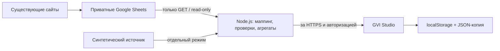

# Минимальная архитектура

Исходный проект: статический HTML, CSS, один JS со стартовыми карточками; из интерактивности — выбор проекта/вкладки и раскрытие действия. Хранения и API не было. Исходный архив ранее импортирован в Git; исходный логотип не изменён.

Сохранены цвета, швейцарская типографика Arial/Helvetica, модульная сетка четырёх проектов, рабочая область и боковое действие. CSS расширен, без фреймворка. `lib/catalog.js` сохраняет исходные задачи и тексты макета. JS развился в CRUD-интерфейс с маршрутами по hash и формами; HTML остаётся простой оболочкой. Никакого отдельного frontend build pipeline.

Google Sheets API выбран потому, что в переданных исходниках нет существующей серверной инфраструктуры Apps Script. У GoogleAuth только spreadsheets.readonly; сервисному аккаунту выдаётся роль читателя. Существующие сайты продолжают работать как прежде. Панель не меняет A2, формулы, записи или статусы. Сырые строки существуют только в памяти сервера до его перезапуска, логирования нет; клиент получает агрегаты. Демо выбирается серверной переменной, пользователь никогда не переводится в него при ошибке рабочего источника.

При рабочем запуске Node слушает loopback за HTTPS reverse proxy, Basic auth защищает все ресурсы. Это компактная защита личной панели на первом этапе, не многопользовательская система. HTTPS и rate limiting прокси обязательны до публикации. Здесь live deployment не выполнен.

## Этапы

- Этап 1 реализован: локальное управление, резервные копии, демо ГТО, мобильная адаптация.
- Этап 2 подготовлен частично: адаптер, конфиг схемы, read-only контракт и тесты с подменённым Google HTTP-клиентом. Запросов к настоящей синтетической Google-таблице ещё не было — нужны доступ и схема.
- Этап 3 не начат: реальные источники и защищённое размещение после согласования правил и теста.
- Этап 4: SQLite и авторизованный CRUD для синхронизации; затем нужные интеграции по отдельным задачам. Пока МЭШ — пространство разработки; SEO — планирование и хранение материалов; ролики — workflow и ручные метрики.

Сцены, связанные материалы и результаты проверок первого прототипа — структурированные поля текста, без автоматического парсинга/связывания. API МЭШ/TikTok/Wordstat и выполнение генерации видео не реализованы. Telegram не используется.
